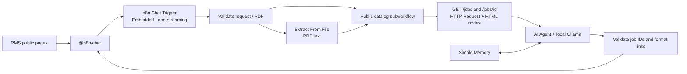

# RMS Recruitment Chatbot Integration

Bộ tích hợp chatbot tuyển dụng cho hệ thống RMS Spring Boot, sử dụng **n8n** và widget nguyên bản **`@n8n/chat`**. Chatbot được thiết kế để tìm việc đang tuyển, giải thích yêu cầu và gợi ý vị trí từ CV PDF bằng model Ollama chạy local.

> **Trạng thái:** đã import hai workflow vào n8n local và áp dụng phần nhúng vào RMS, mặc định tắt. Template được render kiểm tra độc lập; widget được thử trên fixture desktop/mobile. **Chưa nghiệm thu end-to-end** với RMS và model thật. Xem [kết quả kiểm thử](docs/TEST-RESULTS.md). Không có câu trả lời AI giả hoặc dữ liệu job mẫu trong workflow triển khai.

## Mục lục

- [Phạm vi và kiến trúc](#phạm-vi-và-kiến-trúc)
- [Yêu cầu môi trường](#yêu-cầu-môi-trường)
- [Cấu trúc thư mục](#cấu-trúc-thư-mục)
- [Khởi động n8n](#khởi-động-n8n)
- [Import và cấu hình workflow](#import-và-cấu-hình-workflow)
- [Cấu hình Ollama](#cấu-hình-ollama)
- [Nhúng và bật widget trong RMS](#nhúng-và-bật-widget-trong-rms)
- [Hướng dẫn sử dụng](#hướng-dẫn-sử-dụng)
- [Kiểm thử và xử lý lỗi](#kiểm-thử-và-xử-lý-lỗi)
- [Quyền riêng tư và giới hạn](#quyền-riêng-tư-và-giới-hạn)
- [Nguồn tái sử dụng và giấy phép](#nguồn-tái-sử-dụng-và-giấy-phép)

## Phạm vi và kiến trúc



Hai workflow import:

| File | Vai trò |
|---|---|
| [`integration/rms-public-catalog.json`](integration/rms-public-catalog.json) | Đọc trang job công khai; kiểm tra trạng thái tiếp nhận; trả catalog. |
| [`integration/rms-candidate-chat.json`](integration/rms-candidate-chat.json) | Nhận câu hỏi/PDF; gọi catalog; chạy model local; trả phản hồi có kiểm tra ID job. |

Tích hợp không thêm Java Controller/Service/Repository, entity, DTO hoặc bảng. Không sửa business logic, authentication, dependency Spring Boot hoặc SQL Server schema. Không có node tạo Application, cập nhật hồ sơ, gửi email hoặc đặt lịch.

### Nguồn job thực tế và SQL Server

Source RMS hiện có các trang HTML public `/jobs` và `/jobs/{id}`; chưa tìm thấy JSON API public phù hợp. Workflow tái sử dụng hai trang này bằng node native **HTTP Request + HTML**, không kết nối trực tiếp SQL Server.

Trang `/jobs` sử dụng điều kiện thực tế trong `JobPostingRepository`:

```sql
PostingStatus = N'Published'
AND (PostingDate IS NULL OR PostingDate <= CURRENT_TIMESTAMP)
AND (ApplicationDeadline IS NULL OR ApplicationDeadline >= CURRENT_TIMESTAMP)
```

Mỗi trang chi tiết còn phải có badge nhận hồ sơ và không có badge đã đóng. Job chỉ xuất hiện trong lịch sử hội thoại không được coi là vẫn tuyển.

**Lý do không dùng Microsoft SQL node:** quyền `SELECT` trên bảng/cột vẫn có thể đọc các dòng Draft/Paused/Closed. Source schema hiện không có view chỉ chứa job public. Bổ sung view/RLS/procedure để giới hạn dòng sẽ vượt quy định không đổi schema. Đọc public HTML giữ quyền truy cập đúng phạm vi, không cần mật khẩu SQL hoặc tài khoản RMS trong n8n. Kết nối SQL Server của ứng dụng RMS giữ nguyên; không sao chép JDBC username/password sang n8n.

Chi tiết entity, query, controller, auth và selector: [RMS source inspection](research/rms-source-inspection.md).

## Yêu cầu môi trường

| Thành phần | Phiên bản/cấu hình của bộ tích hợp |
|---|---|
| RMS | Checkout `../SWP_RMS_Group-2`; giữ nguyên Spring Boot/Java hiện có. |
| n8n | **2.43.8**, chạy riêng RMS; Docker Compose hoặc npm local. |
| Widget | **`@n8n/chat` 1.42.6**, phân phối nguyên bản, phục vụ từ static assets RMS. |
| Node.js | **>=24.0.0** cho phương án npm; phiên bản đã quan sát trên máy: 24.16.0. |
| Docker | Docker Desktop với Linux containers + Compose, nếu chọn Docker. |
| Model | Ollama local và model do bạn tải; ví dụ cấu hình `qwen2.5:3b`. Chất lượng/tốc độ phải đo trên máy thực. |
| Trình duyệt | Trình duyệt hiện đại có JavaScript modules; `localhost` cho demo local. |

Tại thời điểm kiểm tra, .NET GC báo khoảng 8 GiB tổng bộ nhớ có thể sử dụng; đây **không phải số RAM đang trống**. Chưa tìm thấy Docker/Ollama ở PATH hoặc vị trí cài phổ biến. Khi kiểm tra ban đầu, các cổng RMS 8080/8081/8082, n8n 5678 và Ollama 11434 chưa có dịch vụ trả lời. n8n sau đó đã được cài bằng npm và import workflow bằng CLI. Những giá trị này là ghi nhận của phiên kiểm tra, không phải yêu cầu bắt buộc về cổng.

## Cấu trúc thư mục

```text
chatbot/
├── README.md
├── docs/
│   └── TEST-RESULTS.md
├── integration/
│   ├── rms-candidate-chat.json       # Import vào n8n
│   ├── rms-public-catalog.json       # Import trước workflow chat
│   ├── compose.yaml
│   ├── .env.example                  # Không chứa secret
│   ├── start-local.ps1
│   ├── rms-overlay/                  # Fragment, JS/CSS và widget vendor cho RMS
│   ├── build-chat-workflow.mjs        # Sinh JSON cấu hình, không phải server
│   ├── build-catalog.mjs
│   ├── validate-request.js           # Nội dung Code node: kiểm tra upload
│   └── format-response.js            # Nội dung Code node: kiểm tra ID/format
├── research/
│   ├── rms-source-inspection.md
│   ├── reference-repos.md
│   └── upstream/                     # JSON/source gốc, URL và SHA-256
└── tests/
    └── config-and-guards.test.mjs
```

`.runtime/` chứa runtime npm và state local, được loại khỏi Git. Đây là n8n chính thức, không phải một Node.js backend mới. Không commit `.env`, thư mục state, database n8n hoặc credential export.

## Khởi động n8n

Chọn **một** phương án. Không chạy hai instance cùng cổng 5678.

### Phương án A — Docker Compose

Mở PowerShell trong thư mục `chatbot`:

```powershell
Set-Location .\integration
Copy-Item .env.example .env
```

Tạo một encryption key bằng PowerShell:

```powershell
[Convert]::ToHexString([Security.Cryptography.RandomNumberGenerator]::GetBytes(32))
```

Điền giá trị vừa tạo vào `N8N_ENCRYPTION_KEY` trong `.env`. Đây là secret local, không đưa vào Git hoặc workflow JSON. Giữ key ổn định cùng volume n8n để credential còn giải mã được.

```powershell
docker compose config --quiet
docker compose up -d
docker compose logs --tail 50 n8n
```

Mở [n8n local](http://localhost:5678), tạo tài khoản quản trị **n8n local** trên màn hình thiết lập. Tài khoản này độc lập với tài khoản Candidate/HR của RMS.

Compose chỉ bind n8n vào `127.0.0.1`. Nó không mở editor ra Internet. Để dừng và giữ state:

```powershell
docker compose stop
```

Không dùng `down -v` nếu còn cần workflow/credentials trong volume.

### Phương án B — npm local trên Windows

Từ thư mục `chatbot`:

```powershell
npm.cmd install --prefix .runtime --no-audit --no-fund --omit=dev n8n@2.43.8
powershell -NoProfile -File .\integration\start-local.ps1
```

Script đặt state vào `.runtime/state`, chỉ bind loopback, tắt lưu execution data và giới hạn upload. Mở [n8n local](http://localhost:5678). Dùng `Ctrl+C` trong terminal để dừng.

Trong workspace bàn giao hiện tại, runtime đã được cài và hai workflow đã được import **inactive** vào state riêng. Có thể chạy thẳng `start-local.ps1`; vẫn cần thiết lập tài khoản n8n/model và cấu hình các node. Khi chuyển sang máy khác hoặc state mới, import bằng giao diện như bên dưới hoặc chạy:

```powershell
powershell -NoProfile -File .\integration\start-local.ps1 -Import
```

Trong phiên ngày **2026-10-20**, n8n đã được khởi động tại [http://localhost:5678](http://localhost:5678); health, readiness và editor đều trả HTTP 200. Nếu instance này còn chạy, mở địa chỉ đó để cấu hình, không khởi động instance thứ hai cùng cổng. Workflow chat chưa được publish/model chưa được cấu hình.

Không cần chạy `npm install` trong source RMS hoặc nâng dependency Java. `npm.cmd` được dùng để tránh PowerShell shim `.ps1` bị chặn bởi execution policy.

## Import và cấu hình workflow

1. Mở n8n, chọn **Import from File** và import `rms-public-catalog.json` trước.
2. Trong **RMS Origin Configuration**, sửa hai địa chỉ theo cổng RMS đang chạy thật:

   | Chạy n8n bằng | `rmsInternalBase` | `rmsPublicBase` |
   |---|---|---|
   | npm trên Windows | `http://localhost:8080` | `http://localhost:8080` |
   | Docker Desktop | `http://host.docker.internal:8080` | `http://localhost:8080` |

   `8080` chỉ là giá trị mặc định từ source; nếu RMS của bạn chạy 8082, đổi cả hai sang 8082. Không thêm dấu `/` ở cuối. Không ánh xạ các trường này từ tin nhắn hoặc metadata của widget.

3. Lưu workflow catalog. Với bản demo local, workflow con được gọi bởi workflow chat; không cần mở thêm public webhook cho nó.
4. Import `rms-candidate-chat.json`.
5. Mở node **Read public catalog**, chọn workflow catalog vừa import bằng dropdown. Import từ UI có thể đổi ID, nên không chỉ dựa vào ID được ghi trong JSON.
6. Mở **Candidate chat**:
   - Mode: **Embedded Chat** (`webhook` trong JSON).
   - Authentication: **None** vì dữ liệu đầu vào là job public; đây không phải Spring Security session.
   - Allowed Origins: địa chỉ RMS chính xác, ví dụ `http://localhost:8082,http://127.0.0.1:8082`.
   - Response Mode: **When Last Node Finishes** (`lastNode`).
   - Không bật load previous session hoặc streaming.
7. Chọn local Ollama credential tại node **Local Ollama model** theo phần tiếp theo.
8. Lưu và **Publish/Activate** workflow chat khi sẵn sàng kiểm thử.
9. Sao chép **production Chat URL** mà n8n hiển thị. Không dùng URL `/webhook-test/` cho widget sử dụng bình thường.

JSON bàn giao không có credential secret và mặc định không active. Không import/publish trực tiếp workflow gốc trong `research/upstream`: chúng còn có các nhánh cloud/email/lưu trữ ngoài phạm vi.

## Cấu hình Ollama

Chưa có model/credential đồng nghĩa câu trả lời và CV matching chưa được xác minh. Bộ tích hợp không tự đăng ký dịch vụ trả phí.

1. Cài Ollama từ [nguồn chính thức](https://ollama.com/download/windows).
2. Tải model được chọn, ví dụ:

   ```powershell
   ollama pull qwen2.5:3b
   ollama list
   ```

3. Kiểm tra Ollama đang phục vụ tại `http://localhost:11434`.
4. Trong n8n tạo **Ollama credential**:

   | Môi trường | Base URL |
   |---|---|
   | n8n npm trên Windows | `http://localhost:11434` |
   | n8n Docker Desktop | `http://host.docker.internal:11434` |

5. Chọn credential này trong **Local Ollama model**, đặt model đúng tên từ `ollama list`. Cấu hình mẫu dùng nhiệt độ 0.1 và context 32,768; giảm catalog/text hoặc chọn model phù hợp nếu máy thiếu RAM.

Ollama trên Windows thường chỉ lắng nghe loopback. Nếu container không kết nối được, cần cấu hình Ollama cho phép kết nối từ Docker rồi khởi động lại Ollama; chỉ cho phép mạng local/Docker cần thiết trong firewall, không mở cổng model ra Internet. Phương án npm tránh yêu cầu kết nối từ container.

Compose giới hạn đích HTTP của các node bằng SSRF protection: chỉ hostname `host.docker.internal`; script npm chỉ cho `localhost,127.0.0.1`, đồng thời chặn các IP còn lại. Do đó đổi credential sang provider Internet không phải một thay đổi đã được hỗ trợ. Không tự nới allowlist để gửi CV ra ngoài.

## Nhúng và bật widget trong RMS

Overlay sử dụng fragment chung `fragments/rms-chat.html` và một include tại `fragments/layout/public-topbar.html`. Homepage standalone và các trang `/jobs` dùng chung điểm này; không nhân bản snippet trên từng trang.

Widget vendor được phục vụ từ static assets RMS, không tải JavaScript hoặc CSS từ CDN trong trang Candidate. Các file vendor giữ nguyên license. Chỉ CSS của widget được điều chỉnh màu xanh, font, kích thước và khoảng cách; giao diện RMS sẵn có được giữ nguyên. Source RMS hiện dùng tiếng Việt; nội dung chatbot dùng **English** theo yêu cầu.

Sau khi các file overlay đã được áp dụng, đặt biến môi trường cho **tiến trình RMS** trước khi khởi động bằng cách hiện có của dự án:

```powershell
$env:RMS_CHAT_ENABLED = 'true'
$env:RMS_CHAT_LOCAL_OLLAMA = 'true'
$env:RMS_CHAT_WEBHOOK_URL = 'http://localhost:5678/webhook/6ddb94d7-27d2-4550-88a2-f7a01a1bb645/chat'
```

Thay URL bằng production Chat URL đã sao chép. Chỉ đặt `RMS_CHAT_LOCAL_OLLAMA=true` sau khi xác nhận credential/model chạy local; biến này điều khiển thông báo và nút upload trong widget, không phải một sự chấp thuận gửi CV ra ngoài.

Nếu khởi động bằng IDE, điền các biến tương tự vào Run Configuration rồi restart RMS. Thay đổi biến trong terminal không tự cập nhật tiến trình RMS đã chạy từ trước. Widget mặc định **tắt** để tránh hiển thị một dịch vụ chưa cấu hình.

Để tắt nhanh, bỏ `RMS_CHAT_ENABLED` hoặc đặt `'false'`, rồi restart RMS. Không cần sửa business code/database.

Xem danh sách file áp dụng thực tế trong `integration/rms-files-manifest.json` khi có. Nếu chưa áp dụng overlay, có thể xem các file chuẩn bị trong `integration/rms-overlay` và include trong `integration/public-topbar-insert.txt`.

### File RMS đã thay đổi

Trong checkout `../SWP_RMS_Group-2`:

| Thay đổi | File |
|---|---|
| Thêm đúng một dòng include | `src/main/resources/templates/fragments/layout/public-topbar.html` |
| Fragment mới, điều khiển bằng biến môi trường | `src/main/resources/templates/fragments/rms-chat.html` |
| Khởi tạo widget nguyên bản | `src/main/resources/static/js/rms-chat.js` |
| Theme và reset chỉ trong vùng widget | `src/main/resources/static/css/rms-chat.css` |
| 8 file vendor nguyên bản, có license | `src/main/resources/static/js/vendor/n8n-chat/1.42.6/` |

Manifest ghi đầy đủ từng file và SHA-256. Bản gốc shared topbar trước khi thêm include nằm trong `.runtime/backups/`. Không có thay đổi Java, Spring Security, JDBC configuration, database schema hoặc dependency RMS.

Vendor được đặt dưới `/js/vendor/**` để nằm trong static locations đã được Spring Security cho phép ẩn danh. Không đặt ở `/vendor/**` nếu chưa có public rule tương ứng; bộ tích hợp không thêm rule hoặc thay authentication flow.

Để áp dụng bộ nhúng trên một checkout tương thích khác, kiểm tra trước rồi chạy script additive:

```powershell
powershell -NoProfile -File .\integration\apply-rms-overlay.ps1 -WhatIf
powershell -NoProfile -File .\integration\apply-rms-overlay.ps1
```

Script kiểm tra điểm chèn, backup shared topbar và từ chối ghi đè nếu file đích đã tồn tại với nội dung khác overlay. Script không xóa file. Với checkout khác vị trí, truyền `-RmsRoot` trỏ đúng source RMS đã được review.

## Hướng dẫn sử dụng

1. Mở homepage RMS hoặc trang Jobs.
2. Nhấn nút chat góc dưới bên phải; dùng nút đóng của widget để thu gọn.
3. Nhập câu hỏi tiếng Anh, ví dụ:
   - `What positions are currently open?`
   - `Do you have any Java Developer positions?`
   - `Are there any jobs suitable for fresh graduates?`
   - `Which department is hiring?`
   - `What are the requirements for the first position?`
4. Để matching, đính kèm **một CV PDF có lớp text**, tối đa **5 MiB**, rồi hỏi `Which current jobs best fit my CV?`.
5. Xem các vị trí được gợi ý, kỹ năng phù hợp và các điểm cần đối chiếu thêm. Nhấn tên job để mở trang chi tiết thật của RMS.
6. Hỏi tiếp trong cùng phiên, ví dụ `Tell me more about the first one.`. Refresh trang tạo phiên chat mới.

Chatbot trả tối đa 5 vị trí. Đây là gợi ý định tính do AI ước lượng; không có ATS score hoặc quyết định tuyển dụng. Candidate phải tự xem thông tin và thực hiện ứng tuyển qua luồng RMS hiện có.

## Kiểm thử và xử lý lỗi

Chạy các kiểm tra cấu hình/guard local từ `chatbot`:

```powershell
node --test .\tests\config-and-guards.test.mjs
```

Chúng không gọi LLM, không truy vấn DB và không chứng minh chatbot trả lời đúng. Bộ test thực tế và trạng thái được ghi trong [TEST-RESULTS.md](docs/TEST-RESULTS.md).

Kết quả bổ sung đã ghi nhận: [4 kiểm tra widget fixture](tests/widget-results.json), [19 assertions render Thymeleaf thực tế ở engine độc lập](tests/thymeleaf-fragment-results.md), [native PDF smoke trên n8n](tests/native-results.json). PDF tổng hợp được trích 275 ký tự, có nội dung kỳ vọng và qua readability gate thực tế. Các kiểm tra này chưa chứng minh Embedded multipart hoặc một cuộc hội thoại hoàn chỉnh với RMS/model. Hướng dẫn chạy lại UI fixture nằm trong [báo cáo giao diện](research/widget-ui-verification.md).

### Checklist nghiệm thu với môi trường thật

- Hỏi job đang tuyển và đối chiếu với `/jobs`.
- Tìm theo Java/skills và hỏi yêu cầu/department/JD.
- Upload PDF CV tổng hợp không có PII thật; đối chiếu lý do gợi ý với JD.
- Hỏi lại “the first one” trong cùng phiên.
- Kiểm tra job Closed, chưa Published, ngày đăng tương lai và đã hết hạn không xuất hiện. Chỉ sử dụng fixture đã có hoặc môi trường test; không sửa dữ liệu nghiệp vụ bằng chatbot.
- Thử yêu cầu “apply for me”, cập nhật job/profile và gửi email; không được có thao tác ghi.
- Thử DOCX, MIME/đuôi sai, file giả PDF, nhiều file, file >5 MiB và PDF scan/encrypted.
- Tạm chọn credential/model chưa cấu hình và tạm đổi origin RMS sai; xác nhận thông báo lỗi không lộ secret hoặc HTML nội bộ.
- Kiểm tra header/footer/CTA, widget desktop/mobile và các JavaScript hiện có.

### Lỗi thường gặp

| Hiện tượng | Kiểm tra và xử lý |
|---|---|
| Không thấy nút chat | Biến `RMS_CHAT_ENABLED`; restart đúng tiến trình; kiểm tra include fragment và static assets. |
| Widget báo lỗi phản hồi | n8n đang chạy; workflow đã publish; production Chat URL đúng; CORS khớp hostname/cổng RMS. |
| HTTP 404 ở webhook | Đang dùng URL test, workflow chưa active hoặc URL thay đổi sau import. |
| Model unavailable | Chọn Ollama credential; `ollama list`; đúng model; đúng base URL; đủ RAM/context. |
| Cannot access RMS public job board | Mở `/jobs` trực tiếp; đúng cổng trong node config; Docker dùng `host.docker.internal`; kiểm tra allowlist/network. Không cần sửa SQL credential. |
| Catalog rỗng dù có job | Kiểm tra job Published/ngày hiệu lực; xem selector/badge public có đổi không; workflow bỏ job thiếu title/JD/requirements hoặc đã đóng. |
| Thiếu một số job | Giới hạn 5 trang/20 chi tiết và dữ liệu thay đổi giữa hai GET; đọc cảnh báo coverage. |
| PDF bị từ chối | Một file, MIME PDF, đuôi `.pdf`, chữ ký PDF hợp lệ, <=5 MiB; text trích xuất từ 128 đến 25,000 ký tự. |
| PDF scan không đọc được | Export CV với lớp text. OCR cloud đã được loại bỏ để không tự gửi CV ra bên ngoài. |
| DOCX không upload được | Bản pinned không hỗ trợ DOCX trong Extract From File; chuyển sang PDF. |
| PowerShell chặn npm.ps1 | Dùng `npm.cmd` như các lệnh ở trên. |
| Cảnh báo Python task runner thiếu virtual environment | Các workflow bàn giao dùng JS/native nodes; native PDF smoke đã chạy với JS Task Runner. Không cần thêm Python backend cho tích hợp này. Kiểm tra health và lỗi node thực tế trước khi thay cấu hình. |

## Quyền riêng tư và giới hạn

- **Chỉ đọc:** catalog chỉ dùng GET cố định từ trang public. AI không được cấp SQL, HTTP tool, session cookie hoặc credential RMS. Không tin `role`/`userId` từ frontend.
- **Liên kết được kiểm soát:** chỉ chấp nhận path từ board có dạng `/jobs/{positive integer}`; không theo redirect, URL AI chọn hoặc `/apply`. Phản hồi lấy title/link từ catalog, không từ model.
- **CV ở local:** chỉ cấu hình Ollama local; không có cloud OCR/embedding/provider node trong bản triển khai. Chưa có sự chấp thuận xử lý CV bên ngoài.
- **Lưu trữ:** tắt lưu execution data khi thành công/lỗi/thủ công và progress. Binary mode `default` của phiên bản pinned giữ dữ liệu binary trong RAM; chế độ này đã bị đánh dấu deprecated cho các phiên bản tương lai. Multipart upload vẫn có thể tạo file tạm trước bước chuyển vào RAM. Không có Drive, Sheets hoặc Candidate-profile storage. Simple Memory vẫn giữ nội dung hội thoại/CV trong RAM của n8n; source pinned dọn phiên không hoạt động hơn một giờ khi có lần truy cập memory tiếp theo, và restart xóa memory. Không cam kết xóa tức thì hoặc đã kiểm chứng bằng forensic runtime.
- **Phiên:** session ID mới mỗi lần tải trang, không khôi phục lịch sử vào widget. Session ID không thay thế tài khoản và không được dùng để truy cập dữ liệu riêng tư RMS. Simple Memory không phù hợp queue/multi-worker; cấu hình dùng một instance regular.
- **PDF:** node native đọc text; không OCR local, không DOCX. Chữ ký/MIME/size là kiểm tra đầu vào, không phải chứng nhận file hoàn toàn an toàn. Không upload CV thật trong quá trình debug thủ công nếu chưa cần thiết.
- **Catalog có giới hạn:** tối đa 5 trang board (100 link/trang), 20 job chi tiết; description và requirements tối đa 2,000 ký tự mỗi trường, benefits 1,000. Workflow hiển thị phạm vi một phần/rút gọn; không tuyên bố đây là tìm kiếm đầy đủ khi vượt giới hạn. Nâng giới hạn cần kiểm thử context/RAM/model trước.
- **Phụ thuộc HTML:** khi RMS đổi class/markup public, phải cập nhật selector và chạy kiểm thử lại. Lỗi/thiếu counter được chặn; không thay bằng job giả.
- **Độ chính xác:** kiểm tra ID job ngăn model đưa liên kết job không có trong catalog; giải thích ngôn ngữ tự nhiên vẫn cần nghiệm thu với model thật. Các prompt không phải cơ chế cấp quyền ghi; việc không có tool/credential ghi mới giới hạn thao tác.
- **Triển khai local:** port loopback và cookie HTTP dành cho demo local. Không đưa nguyên cấu hình này lên Internet; triển khai public cần HTTPS, giới hạn tần suất và cấu hình vận hành phù hợp trước.

## Nguồn tái sử dụng và giấy phép

| Nguồn | Phần dùng lại / kết luận |
|---|---|
| [n8n](https://github.com/n8n-io/n8n) | Runtime, node native, AI Agent và memory; chạy độc lập với RMS. |
| [@n8n/chat](https://www.npmjs.com/package/@n8n/chat) | Widget có sẵn; không viết giao diện chat thay thế. npm package và các chunk được giữ nguyên. |
| [Official widget example](https://github.com/n8n-io/n8n/blob/n8n%402.43.8/packages/frontend/%40n8n/chat/resources/workflow.json) | Tái sử dụng topology Chat Trigger/AI Agent/Simple Memory; chuyển model sang Ollama, embedded và non-streaming. |
| [Template 16681](https://n8n.io/workflows/16681-rank-resumes-by-job-description-similarity-using-openrouter-embeddings/) | Tái sử dụng node `Extract PDF Text` nguyên tham số PDF/resume. **Không** tuyên bố đã dùng lại cosine ranking: embeddings/OCR ngoài đã bỏ. |
| [Template 18105](https://n8n.io/workflows/18105-match-cvs-to-remote-jobs-with-groq-google-sheets-and-gmail/) | Điều chỉnh tiêu chí prompt: core function, tránh keyword overlap hời hợt, nêu gap cụ thể. Bỏ điểm ATS, cover letter, scraping, Sheets, Gmail và lưu profile. |
| [GiovAnt99/job-matching-agent](https://github.com/GiovAnt99/job-matching-agent) | Tham khảo; JSON thực tế không có matching node như mô tả README. Không sao chép vào RMS. |
| [Software566/ai-job-search-agent](https://github.com/Software566/ai-job-search-agent) | Tham khảo source matching; là Python app riêng, không có workflow n8n/license rõ ràng; có fallback job mẫu nên không tái sử dụng. |
| [Honey-Singh716 platform](https://github.com/Honey-Singh716/AI-Powered-Resume-Matching-Job-Aggregation-Platform) | App riêng, có ghi profile/gửi CV cloud và fallback dữ liệu giả; không phù hợp phạm vi. |
| [Dify](https://github.com/langgenius/dify) | Có widget/document extraction/Ollama nhưng triển khai lớn hơn, không có lợi thế kỹ thuật đủ để thay n8n ở đây. |

n8n và widget là **source-available/fair-code**, không nên gắn nhãn MIT/OSI open source. Xem [Sustainable Use License](https://docs.n8n.io/sustainable-use-license/) và license nguyên bản đi kèm vendor; có tính năng Enterprise dùng license riêng. Hai trang template ghi dùng miễn phí, nhưng dịch vụ Groq/OpenRouter/OCR/embedding trong bản gốc có hạn mức hoặc phí riêng. Bản triển khai này không tạo tài khoản cloud hoặc yêu cầu các dịch vụ đó. License model Ollama tải về cần kiểm tra riêng theo model.

Các repo tham khảo và Dify có điều kiện license khác nhau; bằng chứng source/commit được ghi trong [reference-repos.md](research/reference-repos.md). JSON/source gốc, version và SHA-256 nằm trong [upstream provenance](research/upstream/provenance.json).

## Bảo trì

- Giữ phiên bản n8n/widget được pin; nâng từng thành phần sau khi kiểm tra schema node, multipart upload và Embedded response mode.
- Nếu sửa JSON trực tiếp trong n8n, export lại **không kèm credentials**, giữ inactive trong source và đối chiếu diff trước khi thay bản bàn giao.
- Các script `build-*.mjs` sinh lại cấu hình từ các node/prompt đã kiểm tra. Chạy chúng sẽ ghi đè JSON tương ứng; không chạy sau khi đã tùy chỉnh thủ công nếu chưa chuyển các thay đổi đó vào builder.
- Không dùng execution debug hoặc ảnh chụp màn hình có CV/credential thật trong tài liệu nộp đồ án.
- Khi báo cáo kết quả, phân biệt **static checks**, **local guard tests**, **n8n runtime**, **RMS live** và **LLM end-to-end**. Chỉ đánh dấu Pass cho lớp đã thực sự chạy.
